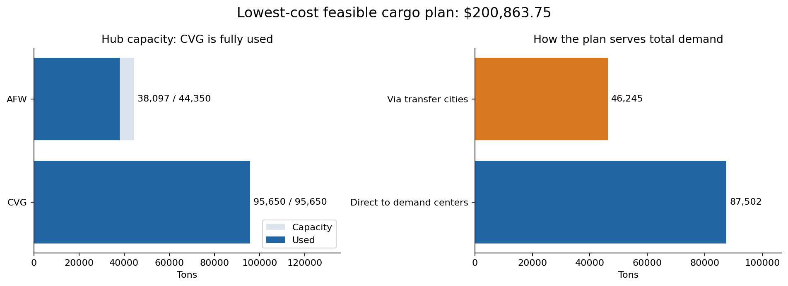

# Cargo network optimization with PuLP

I built a linear program to decide how much freight to send directly from two hubs and how much to route through intermediate cities. The lowest-cost feasible plan served **65 demand centers for $200,863.75** under the supplied lane costs and capacities. Dispatch planners can use that result as a baseline when a hub’s capacity or a lane’s price changes.

*Hub capacity use and shipment quantities in the solved plan.*

[Open the optimization notebook](notebooks/optimization.ipynb) · [Inspect figures from the project report](assets/report-extracts/)

## Results

| Routing decision | Optimal shipment plan |
|---|---:|
| Total demand satisfied | 133,747 tons |
| Shipped directly to demand centers | 87,502 tons |
| Shipped through intermediate cities | 46,245 tons |
| Capacity used at CVG | 95,650 of 95,650 tons |
| Capacity used at AFW | 38,097 of 44,350 tons |

CVG reached its capacity limit while AFW had **6,253 tons available**. A planner evaluating a capacity increase at CVG could rerun the model and compare the change in cost with the price of adding capacity. I calculated the cost of this shipment plan. I did not compare it with an existing plan, so I have not measured savings.

## Network terms

| Term | Meaning in this model |
|---|---|
| Hub | An origin with a limit on total outbound tons |
| CVG / AFW | The two hub identifiers used in the supplied scenario |
| Intermediate / focus city | A transfer point with balanced inbound/outbound flow and a processing limit |
| Demand center | A destination with a required tonnage |
| Lane / unit cost | A directed route and its cost per ton |
| Penalty-cost lane | A missing route assigned a high fallback cost; the solution uses none |

## How the model works

- **Decision variables** represent nonnegative tons on hub-to-center, hub-to-intermediate-city and intermediate-city-to-center lanes.
- **Objective** minimizes the sum of tons shipped on each lane multiplied by its unit cost.
- **Constraints** enforce hub capacity, processing limits at intermediate cities, balanced inbound and outbound flow, and demand at each destination.

I used Python and PuLP to express 331 variables and 73 constraints. The CBC solver returned an optimal solution using 67 lanes. The notebook checks every demand center, validates flow and capacity, and confirms that the solution uses no penalty-cost lanes.

## Run it yourself

Install the [Python dependencies](requirements.txt) in a Jupyter environment with the CBC solver available to PuLP, then run the notebook from the first cell. It contains the demand and lane-cost tables and prints the shipment plan and verification results.

The separate [ABC Logistics fleet-routing proposal](docs/abc-logistics-routing.md) shows how the formulation changes when dispatchers must also assign trucks, meet delivery windows and respect driver-hour limits.

## Data and environment

Data: WGU cargo-routing scenario; [input tables and units](data/README.md).  
Install: `python -m pip install -r requirements.txt`; [environment details](requirements-verified.txt).

*WGU M.S. in Data Analytics coursework, D605 Optimization.*
